# Reverse-Engineering Saudi Bank Installment Calculators

**Role:** Data Analyst. Reverse-engineered both calculators end to end.  
**Goal:** Work out how two Saudi calculators compute their results, without access to their source code.  
**Tools (from the Notion page and screenshots):** Browser dev tools (Network tab), Google Sheets, ChatGPT for formula hypotheses, plus a script that compares web outputs to the model and plots them  
**Calculators studied:** Qarar (affordability) and Al Rajhi Bank (home finance)  

## Background

The aim was to understand exactly how two Saudi calculators arrive at their results, so their numbers could be reproduced.

The two calculators called for different methods:
- **Qarar:** the calculation runs in the browser, so I could read the JavaScript.
- **Al Rajhi:** the calculation runs on the bank's server, so the formula is hidden and had to be inferred.

---

## Part 1: Qarar Affordable Installment Calculator

The calculator is a public affordability tool. I split its variables into what the user controls and what is fixed by the calculator's maker.

| Type | Variables |
|---|---|
| User input | Basic salary, DSR %, APR, term (years), safety-buffer checkbox (0.95 if checked, 1 if not) |
| Fixed by the site | Obligations = 0; monthly expenses total **7,354**, made up of rent 2,770.35, food 1,502.54, education 1,250, housekeeping 800, and smaller items |

Every other field on the page has no effect on either output. Only the two results below matter.

### Affordable installment

The result is the smaller of two caps: one from DSR and one from what's left after fixed expenses.

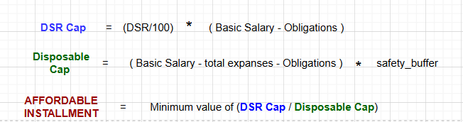

### Implied loan amount

The affordable installment is converted to a loan amount with the standard present-value formula, with a special case when APR is 0.

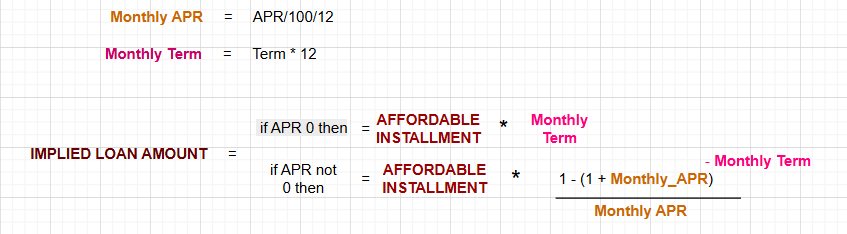

### Confirming it from the page's own script

I read the page's raw JavaScript to check the formulas. The expense table (`DS_OUTPUT`) is hard-coded, `pvFromPmt` is the present-value formula, and `recalc()` takes the minimum of the two caps. One detail differs slightly from the spreadsheet notation: in the script the DSR cap is `DSR% × income − obligations`, not `DSR% × (income − obligations)`. Obligations are hard-coded to 0, so the two give the same result.

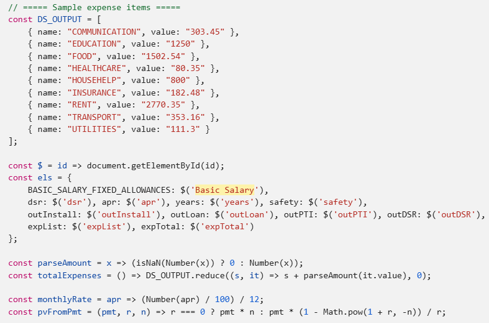
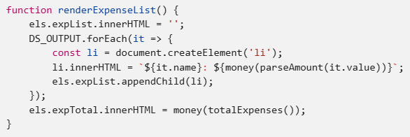

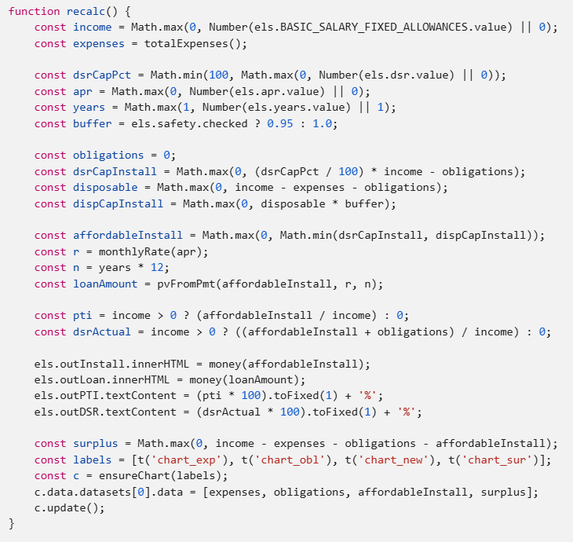

I rebuilt the calculator in Google Sheets from these formulas as a reference implementation.

---

## Part 2: Al Rajhi Home Finance Calculator

### Inputs and the useless fields

The calculator takes eight values: principal, tenure, balloon payment, and five constants (profit rate `atc` 3.2%, admin fee 1.15% capped at 5,750, insurance fee 3,000, valuation fee 300).

The form also asks for **monthly salary** and **current monthly installment**. Those two fields do not affect the result at all. The request the page sends does not include them:

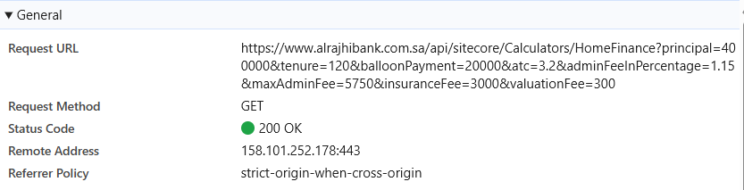
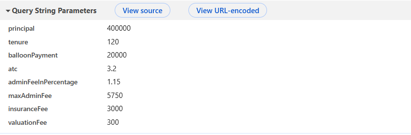

### The formula is not in the page

The calculation happens on the bank's server. The page sends a GET request and displays the JSON that comes back (EMI, APR, finance amount, total payable).

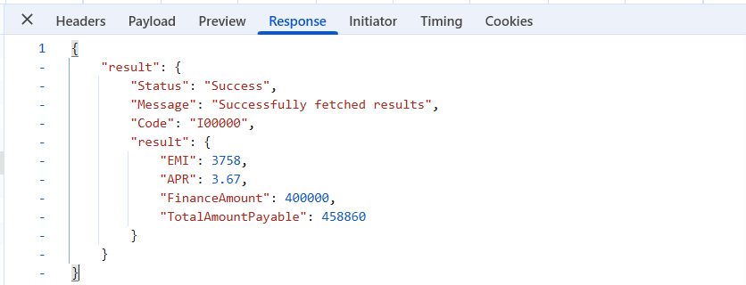

For example, a request with principal 400,000, tenure 120 months and a balloon payment of 20,000 returns EMI 3,758, APR 3.67, finance amount 400,000 and total payable 458,860.

So the exact formula cannot be read. It can only be estimated from input/output pairs.

### Method: inversion

- **Known:** all inputs and outputs.
- **Unknown:** the formula.
- **Idea:** guess a model, compare it to the real outputs, adjust, and repeat until the model matches.

1. I prepared **9 input sets**, varying principal (400,000 to 1.7M), tenure (60 to 300 months) and balloon payment (from 1 up to 200,000), with the five constants held fixed.

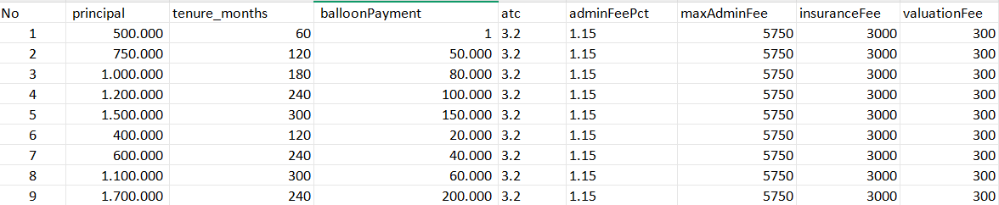

2. I used ChatGPT to propose an initial formula for each of the four outputs.
3. I plotted the web's real outputs against my model's for all 9 sets.
4. Where the curves did not match, I revised the formula and recalculated, until delta and percent error were small.

### The resulting model

With P = principal, B = balloon payment, n = months, ATC = annual profit rate:

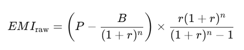
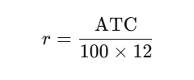

| Output | Model |
|---|---|
| **Monthly payment (EMI)** | Annuity formula on the principal minus the discounted balloon (left above), with monthly rate r = ATC / (100 × 12) |
| **Finance amount** | Equal to the principal P |
| **Total amount payable** | EMI × n + total fees |
| **APR** | (1 + i)^12 − 1, where i is a monthly internal rate of return |

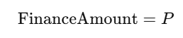
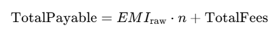
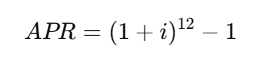

**A check I ran on the example above:** with P = 400,000, B = 20,000, n = 120 and r = 3.2% / 12, the EMI formula gives about 3,757.9, which rounds to the web's 3,758. The web's total payable of 458,860 equals 3,758 × 120 (= 450,960) plus 7,900, and 7,900 is exactly the admin fee (1.15% of 400,000 = 4,600, below the 5,750 cap) plus the insurance fee (3,000) plus the valuation fee (300). So "total fees" is consistent with admin + insurance + valuation, and the balloon payment is not added on top. This is my arithmetic from one example, not something the Notion page states.

The monthly IRR `i` is not directly known. It is found numerically so that the discounted payments equal the net amount disbursed:

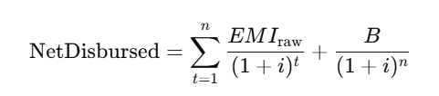

### How well it fits

I compared the model to the web results for the 9 test sets. The Notion page prints the first five rows of each comparison (the charts below cover all 9):

| Output | First five rows |
|---|---|
| EMI | Identical to the web (difference 0) |
| Finance amount | Identical to the web (difference 0) |
| APR | Differences of 0.0001 to 0.0255 APR points (percent error 0.002% to 0.63%) |
| Total payable | Differences of about 10 to 81 currency units on totals of about 0.55M to 2.1M (percent error 0.0006% to 0.0067%) |

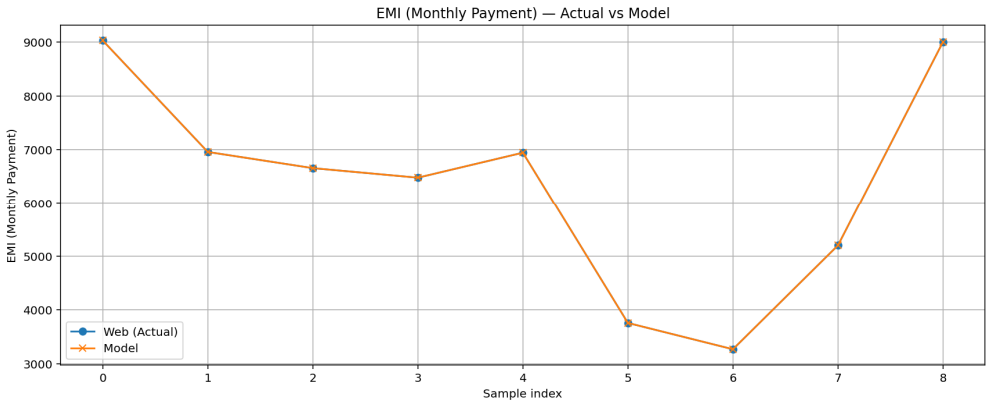
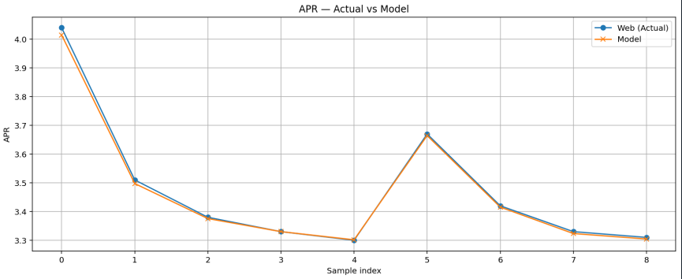

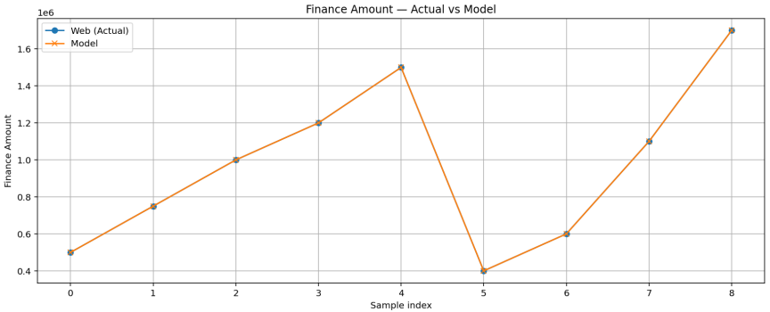
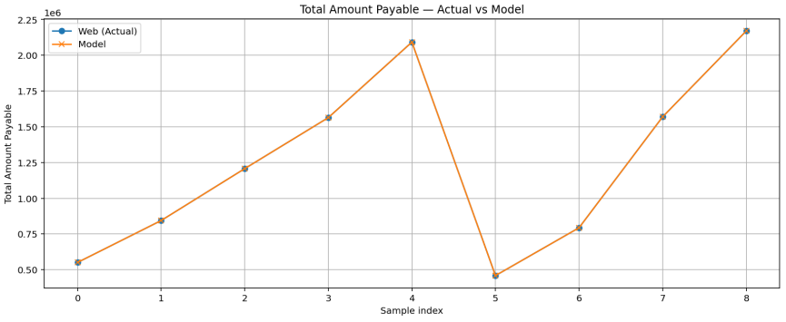

*(Left to right, top to bottom: EMI, APR, finance amount, total payable. Web output in blue, model in orange.)*

## What I took away

- **Read what the page sends, not what it asks for.** Two visible inputs (salary, current installment) had no effect on Al Rajhi's result, which only the network request revealed.
- **When the formula is server-side, inference works.** Nine inputs and an iterate-and-compare loop reproduced EMI and finance amount exactly in the rows shown, and APR and total payable very closely (the model's APR drifts a little from the web's on a few of the 9 samples).
- **The match is an estimate, not proof.** The model fits the 9 test cases. The exact fee structure behind "total fees" is inferred, not confirmed.

<!-- CHECK: "TotalFees" breakdown and the exact solve for i are not spelled out in the Notion page; confirm before publishing. -->
